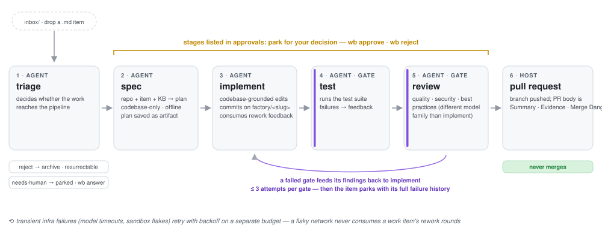

# wb — Factory Workbench

A small, sequentially-processing software factory: drop a markdown task file
into an inbox folder, get a reviewed, pull-request-ready branch out — with
triage, specification, implementation, testing and review handled by agents,
decisions recorded in SQLite, failures bounded, and the whole pipeline
resumable after a crash or an interruption.

Built on [pi](https://github.com/badlogic/pi-mono) (the agent harness, running
inside sandboxes) and [@ai-hero/sandcastle](https://www.npmjs.com/package/@ai-hero/sandcastle)
(Docker sandboxing, git worktrees, named branch strategy). Models run via
Ollama Cloud.

## How it flows

<p align="center">
  
</p>

- **Approval gates:** any stage named in the item's `approvals:` front-matter
  parks for your decision right after completing — `wb status` shows it
  awaiting approval with the stage's artifact ready to read, then
  `wb approve`/`wb reject` drive what happens next.
- **Infra failures are not gates:** model timeouts and sandbox flakes retry
  with backoff under their own budget; a flaky network never consumes a work
  item's rework rounds.

## Prerequisites

- Node 22+ and `npm`
- Docker (OrbStack or Docker Desktop) running, with the sandbox image built:
  `npx sandcastle docker build-image`
- `OLLAMA_API_KEY` exported on the host (Ollama Cloud) — passed to sandbox
  agent sessions
- `gh` CLI pre-authenticated on the host (`gh auth status`) — PR publishing

## Install

```bash
npm install
npm run build          # tsc -> dist
# Optional: the true global verb (spec register: `wb`)
npm link               # exposes `wb` on your PATH
# During development on wb itself, use `npm run wb -- run` (tsx, no rebuild).
```

Note: `npm link` is inside your node version install (mise) — re-run it after
upgrading Node. Without a link, invoke via `npm run wb -- <verb>`.

Initialize a factory root (self-contained and movable):

```bash
wb init
```

This creates a self-contained, movable root:

```text
factory/
├── factory.config.json       # per-stage models, budgets, sandbox image
├── inbox/                    # drop work items here
├── items/
│   └── <slug>/
│       ├── item.md           # the item's source of truth
│       └── artifacts/        # triage report, spec, test log, review verdict, ...
├── archive/                  # triage-rejected items (resurrectable)
├── kb/
│   ├── global.md             # knowledge base: global layer
│   └── projects/<repo>.md    # knowledge base: per-project layer
├── proposals/                # wb curate output — you apply by hand
├── logs/
└── factory.db                # SQLite state; designed for direct UI reads
```

## Usage

Write a work item (see `wb template`):

```markdown
---
title: Implement the thing
repo: /path/to/target/repo
base: main
approvals: []          # stages that stop for human approval, e.g. [spec, review]
---

Describe the task. This file is the item's source of truth.
```

Drop it into `factory/inbox/`, then:

```bash
wb run      # claim inbox + advance every actionable item one stage
wb resume   # drive interrupted/human-rejected items until parked or done
wb status   # everything the factory is doing, waiting on, or blocked by
wb approve <id>          # release a parked approval gate
wb reject <id> --reason "fix the X"   # feedback feeds the next agent run
wb answer <id> -a "..."  # answer parked triage questions; triage re-runs
wb retry <id>            # re-queue a malformed / infra-failed / exhausted-rework item
wb curate [project]      # on-demand KB curation proposal (read-only)
wb gc [--apply] [--json] # reconcile the DB against target repos' git state; report
                          # leaked worktrees/branches (per-repo housekeeping) and, with
                          # --apply, reap the safe subset (terminal items' worktrees and
                          # stale-branch repairs; branches only under --delete-branches)
```

`wb status` is always read-only: it takes no factory lock, claims nothing,
and writes nothing, so it works while `wb run` (or any other wb command) is
active — it reports the lock holder (`factory command in progress (pid …)`)
and any inbox files still awaiting claim instead of failing.

`wb gc` (spec: `specs/wb-gc.spec.md`) is read-only the same way: it never
takes the lock, creates no `factory.db`, and mutates nothing, so it is safe
to run anytime. With `--apply` it becomes a write verb (factory lock taken)
that reaps leaked worktrees of terminal items and stale worktrees holding
resumable items' branches (the crash-recovery repair — the changed-file list
of any dirty reap is recorded into the item's artifacts first, behind
`--force-dirty`). Branches are kept by default; `--delete-branches` deletes
only what is provably merged into the recorded base (local `merge-base`;
squash/rebase merges need `--force-branches` after a probe confirms no open
PR). Orphans (worktrees no item row references) are report-only unless
`--force-orphans` — a rebuilt DB never triggers mass deletion. An unknown
dirty state (a failed probe) holds like dirty, and admin-locked worktrees
(`git worktree lock`) are reported as kept and never unlocked or reaped.

What the operator sees — `wb status` shows every item's state, including *why*
anything is parked:

```text
#2 add-dark-mode [awaiting-approval] stage=implement repo=/Users/me/projects/watchdog
    title: Add dark mode to the settings panel
    source: factory/items/add-dark-mode/item.md
    parked: awaiting-approval
    completed stage: spec
    artifact from spec: items/add-dark-mode/artifacts/20261027-091122-847-spec-spec.md
#3 fix-flaky-watchdog [parked] stage=review repo=/Users/me/projects/watchdog
    title: Add a watchdog for the ingest queue
    source: factory/items/fix-flaky-watchdog/item.md
    parked: exhausted-rework
    gate attempts: review=3
```

Pipeline: **triage → spec → implement → test → review → pull-request**.

- Every agent stage runs in a Docker sandbox bound to a git worktree; commits
  land on a named per-item branch (`factory/<slug>`). The host filesystem is
  never touched beyond git plumbing.
- The test and review stages are gates: a failed gate sends its reasons back
  to the implementer, at most `budgets.maxGateAttempts` total attempts per
  gate, then the item parks with the full failure history.
- Transient infrastructure failures (model timeouts, sandbox flakes) retry
  with backoff under a separate budget; on exhaustion the item parks with a
  distinct reason. A flaky network never consumes rework rounds.
- Approval-gated items produce **draft** PRs; fully autonomous items produce
  ready-for-review PRs. The factory never merges.
- PR bodies follow the PR-skill template — a short Summary (what changes and
  why, plus a diff stat), an Evidence section with artifact digests, and a
  Merge Danger note with a pointer to the item's artifact directory. The
  stage-by-stage chronology stays in the artifacts, not the PR body.

## Configuration

`factory/factory.config.json`:

```json
{
  "root": "/path/to/factory",
  "models": {
    "default": "deepseek-v4.1-flash-1017",
    "implement": "glm-5.3",
    "review": "deepseek-v4-pro:0813"
  },
  "budgets": { "maxGateAttempts": 3, "maxInfraRetries": 3, "retryBackoffMs": 5000 },
  "sandbox": { "imageName": "sandcastle:local" }
}
```

- All stages default to one model; the per-stage override mechanism is the
  mapping structure above.
- Model selection rationale (JSON config files can't carry comments, so it
  is documented in `src/config.ts` next to `DEFAULT_MODEL`): the default
  slot is the best value-per-token model in the Ollama Cloud catalog and
  runs the mechanical stages (triage/spec/test/curate); implement gets the
  strongest long-horizon agent model for the family (GLM 5.3); review must
  be a DIFFERENT model family from implement (ticket 06) so its blind
  spots don't overlap, which is why it keeps DeepSeek V4 Pro. Judge model
  swaps by cost per passed item (factory DB), not benchmark tables.
- `OLLAMA_API_KEY` must be set on the host; only the Ollama Cloud API-key
  env vars are passed into the sandbox `pi` sessions (never the host's
  `auth.json` or `OLLAMA_HOST`), and the staged pi config is mounted
  read-only with a writable session directory. `gh` must be pre-authenticated.

## Knowledge base

`factory/kb/global.md` and `factory/kb/projects/<repo>.md` are dated,
append-only markdown layers. Agents write entries at exactly three moments —
a failed gate (lesson), post-rework (what fixed it), and PR creation (one-line
outcome) — and only ever append. Consuming stages load their designated
layers (triage: lightweight global only; spec/implement/review: global +
project) and are instructed to verify KB facts against the repo before
trusting them. `wb curate` runs a read-only pass that writes a proposal
file (contradictions, repo mismatches, prune candidates) which you apply by
hand.

## Development

- Tests: `npm test` — all pipeline logic runs above a single seam
  (`StageRunner`) against hermetic fake runners; the filesystem and SQLite
  are used for real.
- The one Sandcastle adapter integration test is gated on Docker
  availability + `OLLAMA_API_KEY`; without them it is skipped.
- Typecheck: `npm run typecheck`.

## Architecture notes

- Stage-level durability: SQLite records which stage each item is on; a
  crashed stage run is re-run from the persisted state. Correctness never
  depends on session resume.
- Strictly sequential processing for now; the per-repo lock is already a
  first-class table, so cross-repo parallelism later is a scheduler change.
- See `specs/001-software-factory-mvp.md` for the full spec and
  `tickets/001-software-factory-mvp/` for the ticket-by-ticket contracts.
- For a fully manual, from-scratch walkthrough (markdown in → PR out, with
  expected artifacts at each step), see `docs/demo.md`.