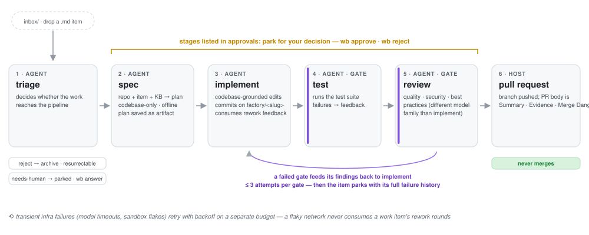

# wb — Factory Workbench

A small, sequentially-processing software factory: drop a markdown task file
into an inbox folder, get a reviewed, pull-request-ready branch out — with
triage, specification, implementation, testing and review handled by agents,
decisions recorded in SQLite, failures bounded, and the whole pipeline
resumable after a crash or an interruption.

Built on [pi](https://github.com/badlogic/pi-mono) (the agent harness, running
inside sandboxes) and [@ai-hero/sandcastle](https://www.npmjs.com/package/@ai-hero/sandcastle)
(Docker sandboxing, git worktrees, named branch strategy). Models run via
Ollama Cloud — or, when the agent provider is switched to Claude Code
(`agent.provider: "claude"` in the config), via Anthropic. The provider is a
config knob below the `StageRunner` seam; everything above it (pipeline,
state machine, gates, KB, PR publishing) is provider-agnostic.

## How it flows

<p align="center">
  
</p>

- **Approval gates:** any stage named in the item's `approvals:` front-matter
  parks for your decision right after completing — `wb status` shows it
  awaiting approval with the stage's artifact ready to read, then
  `wb approve`/`wb reject` drive what happens next.
- **Infra failures are not gates:** model timeouts and sandbox flakes retry
  with backoff under their own budget; a flaky network never consumes a work
  item's rework rounds.

## Prerequisites

- Node 22+ and `npm`
- Docker (OrbStack or Docker Desktop) running, with the sandbox image built:
  `npx sandcastle docker build-image` (for the default `pi` provider) or the
  [claude image](#choosing-the-agent-provider) (for `agent.provider: "claude"`)
- A provider credential exported on the host, injected into the sandbox agent
  sessions via env only (no agent install is needed on the host):
  - `OLLAMA_API_KEY` or `OLLAMA_CLOUD_API_KEY` for the default `pi` provider
    (Ollama Cloud), or
  - `ANTHROPIC_API_KEY` or `CLAUDE_CODE_OAUTH_TOKEN` for `claude` (Claude Code)
- `gh` CLI pre-authenticated on the host (`gh auth status`) — PR publishing

## Install

```bash
npm install
npm run build          # tsc -> dist
# Optional: the true global verb (spec register: `wb`)
npm link               # exposes `wb` on your PATH
# During development on wb itself, use `npm run wb -- run` (tsx, no rebuild).
```

If your Node version manager changes the active Node installation, re-run
`npm link`. Without a link, invoke the CLI via `npm run wb -- <command>`.

Initialize a factory root (self-contained and movable):

```bash
wb init
```

This creates the initial directory layout and default config. State and
runtime files appear as the factory is used:

```text
factory/
├── factory.config.json       # provider, models, review gates, budgets, sandbox, KB limits
├── inbox/                    # drop work items here
├── items/
│   └── <slug>/
│       ├── item.md           # the item's source of truth
│       └── artifacts/        # triage report, spec, test log, review verdict, ...
├── archive/                  # triage-rejected items (resurrectable)
├── kb/                       # global.md and projects/<repo>.md are added as needed
├── proposals/                # wb curate output — you apply by hand
├── logs/
├── factory.db                # SQLite state; created by the first DB-writing command
└── pi-config/                # pi runtime staging; auth.json is never copied for sandbox use
```

## Usage

### Author a work item

The fastest path is the interactive author, which validates the repository and
writes the finished markdown directly into the inbox:

```bash
wb new
```

It prompts for title, repository (including previously used repos), base
branch, approval stages, and description. For scripting, supply the required
fields and a description non-interactively:

```bash
wb new "Implement the thing" \
  --title "Implement the thing" \
  --repo /path/to/target/repo \
  --base main \
  --approvals spec,review
# Use --description-file <path> instead of the positional description, or pipe
# the description on stdin. Omit --approvals for a fully autonomous item.
```

You can also write the file yourself (see `wb template`):

```markdown
---
title: Implement the thing
repo: /path/to/target/repo
base: main
approvals: []          # allowed: triage, spec, implement, test, review
---

Describe the task. This file is the item's source of truth.
```

Drop it into `factory/inbox/`, then run `wb run`.

### Command reference

Every command that operates on a factory accepts `--root <dir>`. For commands
other than `wb init`, `FACTORY_ROOT` is honored when `--root` is absent;
otherwise wb reads `./factory/factory.config.json` and its `root` value,
falling back to `./factory`. `wb init` uses `--root` or `./factory`; it does not
read `FACTORY_ROOT` or an existing config's `root` value.

| Command | What it does |
|---|---|
| `wb init [--root <dir>]` | Create the factory layout and default config. |
| `wb template` | Print a work-item markdown template. |
| `wb new [description]` | Author an item interactively or with `--title`, `--repo`, `--base`, `--approvals`, and `--description-file`. |
| `wb run` | Claim inbox items and advance every actionable item by one stage. |
| `wb resume` | Recover interrupted/rejected items and continue until they park or finish. |
| `wb status [--all]` | Show items other than completed ones and their parked reasons; `--all` includes done items. |
| `wb watch [--interval <seconds>]` | Poll read-only for new events, show a compact status card, and notify when items park (default: 5 seconds; Ctrl+C to stop). |
| `wb approve <id-or-slug> [-n <note>]` | Release a parked approval gate. |
| `wb reject <id-or-slug> -r <reason>` | Reject stage output; the reason becomes rework feedback. |
| `wb answer <id-or-slug> -a <answers...>` | Answer parked triage questions in order; triage re-runs. |
| `wb retry <id-or-slug>` | Re-queue malformed, infrastructure-failed, or exhausted-rework items. Fix malformed front-matter first. |
| `wb curate [projects...]` | Write a KB curation proposal for selected projects, or all known projects. Never edits the KB itself. |
| `wb gc [options]` | Reconcile factory state with target repos; report by default, reap safe resources with `--apply`. |

`wb gc` also accepts `--json`, `--delete-branches`, `--force-branches`,
`--force-dirty`, and `--force-orphans`. The mutating flags require `--apply`;
`--force-branches` is meaningful only with `--delete-branches`. See the safety
rules below or `wb gc --help`.

`wb status`, `wb watch`, and report-mode `wb gc` are read-only: they take no
factory lock, claim nothing, and do not create or write `factory.db`, so they
work while another wb command is active. `status` also reports the lock holder
and inbox files awaiting claim. `watch` only observes the factory—it does not
advance items—and offers best-effort parked-item notifications on macOS and
Linux.

Before an item's first stage run of a round, `wb run`/`wb resume` check the
item's base branch (`base:` front-matter, typically `main`) against its
upstream: a best-effort `git fetch origin` runs on the host, and if the
local base is strictly behind `origin/<base>` the item is skipped for that
round and reported (local vs upstream tips) instead of working against a
base missing already-merged work. A failed fetch — offline, no remote — only
warns and proceeds, so the factory stays usable offline. The factory never
pulls; the remedy is on your side: `git pull` the target repo, then re-run.

`wb gc` (spec: `specs/wb-gc.spec.md`) is read-only the same way: it never
takes the lock, creates no `factory.db`, and mutates nothing, so it is safe
to run anytime. With `--apply` it becomes a write verb (factory lock taken)
that reaps leaked worktrees of terminal items and stale worktrees holding
resumable items' branches (the crash-recovery repair — the changed-file list
of any dirty reap is recorded into the item's artifacts first, behind
`--force-dirty`). Branches are kept by default; `--delete-branches` deletes
only what is provably merged into the recorded base (local `merge-base`;
squash/rebase merges need `--force-branches` after a probe confirms no open
PR). Orphans (worktrees no item row references) are report-only unless
`--force-orphans` — a rebuilt DB never triggers mass deletion. An unknown
dirty state (a failed probe) holds like dirty, and admin-locked worktrees
(`git worktree lock`) are reported as kept and never unlocked or reaped.

What the operator sees — `wb status` shows each item that is not done,
including *why* anything is parked (add `--all` to include done items):

```text
#2 add-dark-mode [awaiting-approval] stage=implement repo=/Users/me/projects/watchdog
    title: Add dark mode to the settings panel
    source: factory/items/add-dark-mode/item.md
    parked: awaiting-approval
    completed stage: spec
    artifact from spec: items/add-dark-mode/artifacts/20261027-091122-847-spec-spec.md
#3 fix-flaky-watchdog [parked] stage=review repo=/Users/me/projects/watchdog
    title: Add a watchdog for the ingest queue
    source: factory/items/fix-flaky-watchdog/item.md
    parked: exhausted-rework
    gate attempts: review=3
```

Pipeline: **triage → spec → implement → test → review → pr**.

- Every agent stage runs in a Docker sandbox bound to a git worktree; commits
  land on a named per-item branch (`factory/<slug>`). Target-repository changes
  stay in that worktree; host-side writes are limited to factory state and git
  worktree/branch plumbing.
- The test and review stages are gates: a failed gate sends its reasons back
  to the implementer, at most `budgets.maxGateAttempts` total attempts per
  gate, then the item parks with the full failure history.
- Transient infrastructure failures (model timeouts, sandbox flakes) retry
  with backoff under a separate budget; on exhaustion the item parks with a
  distinct reason. A flaky network never consumes rework rounds.
- Approval-gated items produce **draft** PRs; fully autonomous items produce
  ready-for-review PRs. The factory never merges.
- PR bodies follow the PR-skill template — a short Summary (what changes and
  why, plus a diff stat), an Evidence section with artifact digests, and a
  Merge Danger note with a pointer to the item's artifact directory. The
  stage-by-stage chronology stays in the artifacts, not the PR body.

## Configuration

`factory/factory.config.json` is created by `wb init`. This is the generated
default configuration (with the machine-specific root path abbreviated):

```json
{
  "root": "/path/to/factory",
  "models": {
    "default": "deepseek-v4-pro:0813",
    "review": "glm-5.3-flash"
  },
  "agent": { "provider": "pi" },
  "budgets": { "maxGateAttempts": 3, "maxInfraRetries": 3, "retryBackoffMs": 5000 },
  "sandbox": { "imageName": "sandcastle:local" },
  "kb": { "maxGlobalChars": 24000, "maxProjectChars": 24000 }
}
```

All stages inherit `models.default` unless overridden by a stage key
(`triage`, `spec`, `implement`, `test`, `review`, or `curate`). The generated
pi defaults intentionally use a different model family for review. Judge model
changes by cost per passed item, using the model and gate outcomes recorded in
the factory DB, rather than benchmarks alone. Model IDs are not checked against
a live catalog, so an unknown ID surfaces when its stage runs.

For multiple sequential review lenses, add an optional `review` block:

```json
{
  "review": {
    "gates": [
      { "name": "quality" },
      {
        "name": "performance",
        "model": "deepseek-v4-pro:0813",
        "extraInstructions": "Focus on regressions in hot paths."
      }
    ]
  }
}
```

- **Review gates:** `name` selects built-in `quality` (the classic three-axis
  review) or `performance` (Workbench performance lens). Any other unique,
  path-safe name (lowercase alphanumeric segments joined by single hyphens)
  uses a generic lens guided by `extraInstructions`. `model` overrides the
  gate's model; otherwise it inherits `models.review`, then `models.default`.
  With no `review` key, exactly one implicit `quality` gate runs. Gates execute
  sequentially and fail fast within one review stage, sharing the stage's
  `budgets.maxGateAttempts` budget. A single-gate run writes `review-verdict`;
  a multi-gate run also writes `review-verdict:<name>` per gate and, after all
  gates pass, a combined `review-verdict` for the PR body. Stage history records
  each gate in `usage.profiles`; `usage.model` remains the first gate's model.
- **KB prompt limits:** `kb.maxGlobalChars` and `kb.maxProjectChars` bound the
  global and per-project layers loaded into full stages and curation batches.
- **pi credentials and staging:** set `OLLAMA_API_KEY` or
  `OLLAMA_CLOUD_API_KEY` on the host. Only those API-key vars reach sandboxed
  pi sessions—never `OLLAMA_HOST` or the host's `auth.json`. Each run mounts a
  fresh, writable copy of the minimal staged pi config (pi must write its
  settings lock and session files). Writes in that copy persist only until the
  item's next stage or runner cleanup; they never become durable agent state.
  `gh` must be pre-authenticated on the host for PR publishing.

### Choosing the agent provider

`agent.provider` selects which agent runtime backs every stage below the
`StageRunner` seam. Everything above the seam — pipeline, state machine,
SQLite, inbox/KB, gates, PR publishing — is provider-agnostic.

| | `pi` (default) | `claude` |
|---|---|---|
| Credential env (host → sandbox) | `OLLAMA_API_KEY` / `OLLAMA_CLOUD_API_KEY` | `ANTHROPIC_API_KEY` **or** `CLAUDE_CODE_OAUTH_TOKEN` (whichever is set) |
| Sandbox image | `sandcastle:local` (`npx sandcastle docker build-image`) | a claude-enabled image, e.g. `sandcastle:claude`, set via `sandbox.imageName` |
| Default models | Ollama Cloud ids (`src/config.ts`) | `claude-sonnet-5-5` default, `claude-opus-5-5` review |
| pi-config staging (agent-dir mounts, npm prefix) | yes | no — claude needs only env injection |

Only the provider's own credential env vars are ever passed into a sandbox
run (a `claude` run never sees Ollama credentials, a `pi` run never sees
Claude credentials; no endpoint vars like `OLLAMA_HOST` / `ANTHROPIC_BASE_URL`
are forwarded — same redirect-attack reasoning). No `claude` install is
needed on the host: the `claude` CLI is baked into the image and auth rides
sandbox env only.

To use Claude Code, change the generated config's provider, models, and image
(keeping the existing `root`, `budgets`, and `kb` values):

```json
{
  "agent": { "provider": "claude" },
  "models": {
    "default": "claude-sonnet-5-5",
    "review": "claude-opus-5-5"
  },
  "sandbox": { "imageName": "sandcastle:claude" }
}
```

Then export one of `ANTHROPIC_API_KEY` or `CLAUDE_CODE_OAUTH_TOKEN` and build
the image as shown below. `implement` and the other unoverridden stages inherit
`models.default`; per-stage and per-review-gate overrides work as they do for
pi. You can also remove `models` entirely to use the Claude defaults.

**Claude model defaults and validation:** under `pi` the intended invariant is
"review is a different model FAMILY from implement"; under `claude` (a single
family) it becomes "review is a different model from implement"—sonnet runs the
default/implement stages and opus runs review. Under `claude`, every configured
model must be a `claude-*` ID or an alias (`sonnet`, `opus`, `haiku`, or
`opusplan`), optionally with a `[1m]` suffix. This is checked at startup, so
switching a pi-generated config to `claude` requires replacing or removing its
Ollama `models` entries. Beyond that shape check there is no live catalog
validation; an unknown Claude ID still surfaces when a stage runs.

**Building the claude image** — the UID/GID build-args are REQUIRED:
Sandcastle's docker provider inspects the image's default user
(`docker image inspect …{{.Config.User}}`) and refuses to start a sandbox on
UID mismatch with the host user; building without the args makes every
stage abort with `UID mismatch: image 'sandcastle:claude' …`:

```bash
docker build -f docker/claude.Dockerfile \
  --build-arg AGENT_UID="$(id -u)" --build-arg AGENT_GID="$(id -g)" \
  -t sandcastle:claude .
```

The Dockerfile mirrors sandcastle 0.12's Claude template (see its header).
Alternative documented path: `sandcastle init --agent claude-code` in a
scratch dir + `npx sandcastle docker build-image`. The pi image keeps
working unchanged for provider `pi`.

**Acceptance note — one-stage triage spike before relying on `claude`:**
structured-output `<tag>…</tag>` compliance is prompt-enforced and
model-dependent, so before relying on provider `claude`, run a single-item
triage spike against a real repo with `agent.provider: "claude"` and a trivial
triage task. Watch `wb status` and the item's artifacts for a parseable
`<triage>` verdict. Real validation needs Docker, the built Claude image, and
one supported Claude credential. It is not required for the factory's own test
suite: the gated Claude integration smoke skips without the credential/image.
Structured-output parse failures are infra-class failures retried under
`budgets.maxInfraRetries`.

## Knowledge base

`factory/kb/global.md` and `factory/kb/projects/<repo>.md` are dated,
append-only markdown layers. Agents write entries at exactly three moments —
a failed gate (lesson), post-rework (what fixed it), and PR creation (one-line
outcome) — and only ever append. Consuming stages load their designated
layers (triage: lightweight global only; spec/implement/review: global +
project) and are instructed to verify KB facts against the repo before
trusting them. `wb curate` runs a read-only pass that writes a proposal
file (contradictions, repo mismatches, prune candidates) which you apply by
hand.

## Development

- Tests: `npm test` — pipeline logic runs above the `StageRunner` seam against
  hermetic fake runners, with real filesystem and SQLite access. Provider
  selection (pi vs claude) is covered by hermetic adapter tests
  (`tests/agent-provider.test.ts`) that verify provider dispatch and
  credential/staging gating—no Docker, Claude Code, or pi required.
- Docker-backed Sandcastle integration tests are optional. The pi tests require
  Docker plus `OLLAMA_API_KEY`; the Claude smoke requires Docker, the
  `sandcastle:claude` image, and `ANTHROPIC_API_KEY` or
  `CLAUDE_CODE_OAUTH_TOKEN`. They skip when their requirements are unavailable.
- Typecheck: `npm run typecheck`. Build: `npm run build`. CI runs both before
  the test suite.

## Architecture notes

- Stage-level durability: SQLite records which stage each item is on; a
  crashed stage run is re-run from the persisted state. Correctness never
  depends on session resume.
- Strictly sequential processing for now; the per-repo lock is already a
  first-class table, so cross-repo parallelism later is a scheduler change.
- See `specs/001-software-factory-mvp.md` for the full spec and
  `tickets/001-software-factory-mvp/` for the ticket-by-ticket contracts.
- For a fully manual, from-scratch walkthrough (markdown in → PR out, with
  expected artifacts at each step), see `docs/demo.md`.